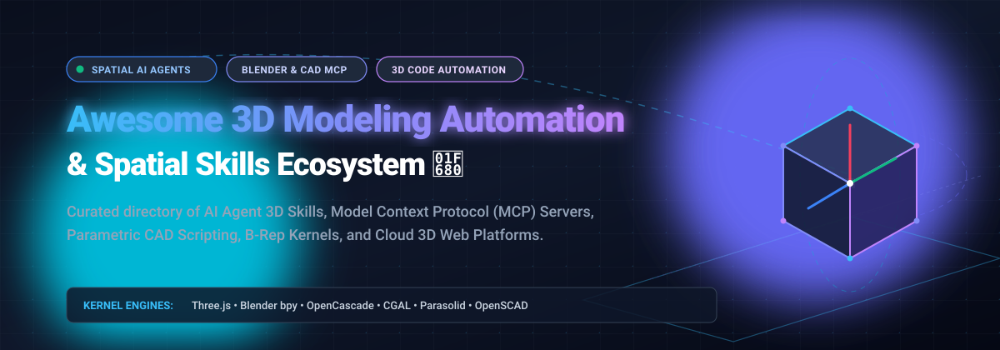

# Awesome-3D-Modeling-Automation-Spatial-Skills

  

  
  
  
  
  

---

## 🎯 Overview & Vision

A comprehensive, production-grade curated list of **3D Modeling Automation, AI Spatial Agent Skills, CAD Scripting Engines, and Cloud 3D SaaS Platforms**. 

As Large Multimodal Models (LMMs) and autonomous coding agents like **Claude Code, Cursor, Codex, and Gemini CLI** evolve, 3D modeling workflows are transitioning from manual manual point-and-click interactions to **agentic spatial reasoning**, **Model Context Protocol (MCP)** tool execution, and **code-first parametric solid modeling**. This repository tracks the ecosystem driving this architectural leap forward.

---

## 📑 Table of Contents

- [🌐 Sector Overview & Market Dynamics](#-sector-overview--market-dynamics)
- [☁️ SaaS & Hosted Platforms](#️-saas--hosted-platforms)
- [🛠️ Open-Source GitHub Projects](#️-open-source-github-projects)
  - [Top Open-Source 3D Engines & Automation Repositories](#top-open-source-3d-engines--automation-repositories)
  - [Modular Agent Skills & MCP Ecosystem](#modular-agent-skills--mcp-ecosystem)
- [📈 Star History](#-star-history)
- [🤝 How to Contribute](#-how-to-contribute)
- [💖 Support & Sponsorship](#-support--sponsorship)
- [⚖️ Disclaimer & License](#️-disclaimer--license)

---

## 🌐 Sector Overview & Market Dynamics

The global 3D modeling and spatial software market is estimated at **$7.6 billion to $10.5 billion in 2025** and is projected to expand to **$8.6 billion to $12.6 billion by 2026**, registering a compound annual growth rate (CAGR) of 13% to 17% through the early 2030s. 

The competitive landscape represents a **bifurcated market structure**: the enterprise foundational CAD and AEC tier is **heavily concentrated and oligopolistic** (dominated by entrenched enterprise incumbents like Autodesk, PTC, and Trimble), whereas the emerging layer of cloud-native WebGL studios, generative 3D pipelines, and AI agent spatial tooling remains **highly fragmented** with specialized startups competing in rapid cycles.

---

## ☁️ SaaS & Hosted Platforms

The table below catalogs notable SaaS and commercial hosted platforms across browser CAD, procedural geometry, generative 3D, and collaborative WebGL studios, ranked by company size (valuation / annual revenue, descending).

| SaaS / Hosted Platform | Description | Valuation / Revenue | Starting Paid Tier Pricing | Free Tier / Trial Limit |
| :--- | :--- | :--- | :--- | :--- |
| **[Autodesk Tinkercad](https://tinkercad.com)** | Browser-based constructive solid geometry (CSG) modeler and Codeblocks visual scripting studio designed for rapid prototyping and education. | Parent (Autodesk) **~$63B** Market Cap / **$6.13B** Annual Revenue (FY25) | **$0** (Fully Free Service provided by Autodesk) | **Unlimited Free Plan** (No expiration, full access to 3D Design, Circuits, Codeblocks, and Sim Lab; standard personal/educational licensing) |
| **[Autodesk Meshmixer](https://meshmixer.com)** | 3D triangle mesh cleanup, remeshing, sculpting, hollowing, and 3D printing support generation utility (desktop freeware). | Parent (Autodesk) **~$63B** Market Cap / **$6.13B** Annual Revenue (FY25) | **$0** (Freeware, legacy utility) | **Unlimited Free Plan** (Free download binary; retired from active maintenance with features transitioning to Autodesk Fusion) |
| **[SketchUp (Web & Go)](https://sketchup.com)** | Cloud-connected 3D architectural massing, conceptual modeling, and Trimble Connect collaboration platform with Ruby API automation. | Parent (Trimble) **~$18.6B** Market Cap / **$3.59B** Annual Revenue (FY25) | **$129 / year** (SketchUp Go; ~$10.75/month billed annually) | **SketchUp Free: 10 GB cloud storage limit** on Trimble Connect, browser-only modeling, standard personal non-commercial use, no desktop extensions |
| **[Onshape](https://onshape.com)** | Cloud-native multi-user parametric 3D CAD system featuring integrated Git-style version branching and FeatureScript procedural modeling automation. | Parent (PTC) **~$21B** Market Cap (Acquired for **$470M**; ~$2.3B PTC ARR) | **$1,500 / user / year** (Onshape Standard; billed annually) | **Free Public Plan: 100% public workspace only** (no private documents, strictly non-commercial hobbyist/maker use, 2,500 annual API call limit) |
| **[Shapr3D](https://www.shapr3d.com/)** | Multi-device parametric direct modeler powered by the Siemens Parasolid kernel with industrial drawing output and cloud sync. | **~$14.6M** ARR (Est. Private; ~$7.3M venture funding raised) | **$25 / month** ($299 / year billed annually for Solo tier; $37.99/mo month-to-month) | **Basic Free Plan: Maximum 2 active projects**, low-resolution STL/3MF exports only (no STEP/IGES), and capped at 20 generative renders/month |
| **[Spline](https://spline.design)** | Collaborative real-time 3D browser design and interaction engine with AI generation, physics simulation, and React/three.js web exports. | **~$4.7M** ARR (Est. Private; raised $10M Series A, $32M total funding) | **$12 / month** (Hobby plan billed annually; $15/month billed monthly) | **Free Plan: Unlimited viewers, access to basic Spline Library**, but exports include Spline watermark and limited monthly AI compute credits |
| **[Vectary](https://vectary.com)** | Collaborative browser-based 3D design and product configurator platform with parametric primitives, WebGL embeds, and AR viewing. | **~$3.2M** ARR (Est. Private; ~$37M valuation tracking, ~$10M funding) | **$15 / month** (Pro plan billed annually at $180/year; $19/month billed monthly) | **Starter Free Plan: Up to 5 active projects**, 1 workspace seat, 3,000 monthly AI credits, and published embeds carry Vectary watermark |
| **[Blender Studio (Cloud)](https://blender.org)** | Collaborative open-movie production asset cloud, training archive, and asset manager supporting Blender procedural pipelines and Geometry Nodes. | **€3.11M (~$3.4M)** Annual Foundation Income (Non-profit entity) | **€11.50 / month** (~$12.50/month individual membership) | **Blender Core App is 100% Free** forever without limits; Blender Studio cloud platform offers select free public open-movie assets and documentation |
| **[SelfCAD](https://selfcad.com)** | All-in-one browser 3D modeler, digital sculpting suite, polygon repair toolkit, and integrated slicing utility for additive manufacturing. | **~$2.5M** ARR (Est. Private bootstrapped) | **$14.99 / month** (Pro plan; or $139.99 billed annually) | **10-day full Pro Free Trial**, automatically converting to Free Plan (standard basic modeling and slicing active; high-res renderer and animation tools locked) |
| **[Clara.io](https://clara.io)** | Pioneer cloud polygonal 3D modeler, REST API renderer, and WebGL animation studio (acquired and underlying tech transitioned to Threekit). | Acquired / Transitioned to enterprise 3D commerce platform Threekit | Legacy service retired | **Service Discontinued** (Legacy platform officially shuttered on Dec 31, 2022; historical pioneer in cloud WebGL polygon pipelines) |

---

## 🛠️ Open-Source GitHub Projects

Below is the definitive catalog of open-source projects for 3D modeling engines, boundary-representation (B-Rep) CAD frameworks, mesh decimation utilities, and AI Agent spatial reasoning toolkits. 

Repositories are **strictly sorted by GitHub star counts in descending order**. Click on any star badge to inspect real-time stargazers.

### Top Open-Source 3D Engines & Automation Repositories

| Repository & Stargazers | Description | License |
| :--- | :--- | :--- |
| **[mrdoob/three.js](https://github.com/mrdoob/three.js)**  | The standard JavaScript 3D engine powering browser-based 3D applications, WebGL/WebGPU pipelines, parametric shaders, and agentic web-scene automation. | `MIT` |
| **[FreeCAD/FreeCAD](https://github.com/FreeCAD/FreeCAD)**  | Parametric open-source 3D CAD/BIM modeler built with modular C++/Python workbenches, OpenCASCADE geometry kernel, FEM simulation, and full macro automation. | `LGPL-2.0+` |
| **[blender/blender](https://github.com/blender/blender)**  | The premier open-source 3D creation suite featuring non-destructive Geometry Nodes, Cycles/EEVEE real-time engines, and extensive `bpy` Python API automation. | `GPL-2.0+` |
| **[isl-org/Open3D](https://github.com/isl-org/Open3D)**  | Modern C++ and Python library for 3D data processing, point cloud registration, surface reconstruction, voxel hashing, and robotics spatial perception. | `MIT` |
| **[openscad/openscad](https://github.com/openscad/openscad)**  | Script-driven constructive solid geometry (CSG) CAD compiler that deterministically generates 3D solid parts from code for mechanical engineering and 3D printing. | `GPL-2.0+` |
| **[prusa3d/PrusaSlicer](https://github.com/prusa3d/PrusaSlicer)**  | Open-source G-code generator and mesh slicing engine with CLI automation and variable layer height algorithms for additive manufacturing pipelines. | `AGPL-3.0` |
| **[CadQuery/cadquery](https://github.com/CadQuery/cadquery)**  | Python-based parametric boundary-representation (B-Rep) CAD modeling framework built on OpenCASCADE for scripted mechanical parts and assemblies. | `Apache-2.0` |
| **[cnr-isti-vclab/meshlab](https://github.com/cnr-isti-vclab/meshlab)**  | Advanced 3D triangular mesh processing system for mesh inspection, hole filling, surface decimation, quadric error remeshing, and batch cleaning. | `GPL-3.0` |
| **[bambulab/BambuStudio](https://github.com/bambulab/BambuStudio)**  | Cutting-edge 3D print slicing software with cloud sync, multi-material optimization, remote machine telemetry, and automated STEP mesh slicing. | `AGPL-3.0` |
| **[solvespace/solvespace](https://github.com/solvespace/solvespace)**  | Lightweight parametric 2D/3D constraint-based CAD modeler and kinematic linkage solver with instant STEP/DXF export capabilities. | `GPL-3.0` |
| **[gumyr/build123d](https://github.com/gumyr/build123d)**  | Next-generation Python CAD programming library built upon OpenCASCADE using intuitive Python context managers for direct B-Rep solid geometry generation. | `Apache-2.0` |
| **[jscad/OpenJSCAD.org](https://github.com/jscad/OpenJSCAD.org)**  | Programmatic 3D CAD modeling in JavaScript and TypeScript, enabling browser-native constructive solid geometry execution and instant WebGL previews. | `MIT` |
| **[dune3d/dune3d](https://github.com/dune3d/dune3d)**  | Free and open-source parametric 3D CAD application supporting geometric constraints, 3D sketch planes, chamfers, fillets, and STEP exports. | `GPL-3.0` |
| **[cnr-isti-vclab/PyMeshLab](https://github.com/cnr-isti-vclab/PyMeshLab)**  | Python interface to the MeshLab C++ core enabling headless automation of filters, batch mesh cleaning, point cloud conversions, and remeshing scripts. | `GPL-3.0` |

---

### Modular Agent Skills & MCP Ecosystem

These frameworks empower LLM agents (Claude Code, Cursor, Codex, OpenCode, Gemini CLI) to perceive 3D environments, drive Blender headlessly, generate Three.js scenes, and reason geometrically.

| Agent Skill / MCP Framework | Description | License |
| :--- | :--- | :--- |
| **[Moh4696/open-3d-skills](https://github.com/moh4696/open-3d-skills)**  | Suite of eight modular agent skills (`threejs-scene`, `scroll-film`, `motion-assets`, `alpha-cutout`, `cursor-rig`, `exploded-view`, `site-check`, `frame-capture`) for coding agents to generate 60 fps 3D websites. | `MIT` |
| **[XliuXjianX/blender-production-skills](https://github.com/XliuXjianX/blender-production-skills)**  | Production-grade Blender agent skill suite for Codex covering procedural modeling, Geometry Nodes, physics setups, materials, and reference reconstruction. | `MIT` |
| **[elithril/blender-kiln](https://github.com/elithril/blender-kiln)**  | Claude Code skill plugin that converts descriptive text and reference images into clean, rigged, 3D-printable or game-ready assets inside Blender. | `MIT` |
| **[HoldMyBeer-gg/blenderwright](https://github.com/HoldMyBeer-gg/blenderwright)**  | Comprehensive Model Context Protocol (MCP) server for Blender exposing hundreds of modeling, procedural material, lighting, and rendering tools to Claude & Cursor. | `MIT` |
| **[majidmanzarpour/blender-game-skills](https://github.com/majidmanzarpour/blender-game-skills)**  | Specialized agent skill collection designed to automate low-poly game asset generation, automated UV unwrapping, and glTF export pipelines in Blender. | `MIT` |
| **[RobLe3/cc-blender-skill](https://github.com/RobLe3/cc-blender-skill)**  | Claude Code skill plugin with 10 chain-loadable skills for natural language manipulation of Blender 5.x scene meshes, material shaders, and cameras. | `MIT` |
| **[samffprice/loopcut](https://github.com/samffprice/loopcut)**  | Natural-language AI copilot and agentic assistant integrated directly into Blender for conversational mesh modeling, modifier adjustments, and scene composition. | `GPL-3.0` |
| **[VINHYU/OpenSpatial](https://github.com/VINHYU/OpenSpatial)**  | ECCV open-source 3D spatial understanding data engine (`OpenSpatial-3M`) lifting monocular RGB video into metric depth, camera trajectories, and oriented bounding boxes. | `Apache-2.0` |
| **[3DSceneAgent/Vibe3DScene](https://github.com/3DSceneAgent/Vibe3DScene)**  | Automated 3D scene synthesis framework that parses open-ended user textual descriptions into cohesive multi-object spatial scene layouts. | `Apache-2.0` |
| **[seehiong/blender-mcp-bridge](https://github.com/seehiong/blender-mcp-bridge)**  | AI automation bridge providing 93 MCP tools across polygonal modeling, sculpting, architectural/MEP massing, shader setup, and 3D print validation. | `MIT` |
| **[skill-3d/Skill-3D](https://github.com/skill-3d/Skill-3D)**  | Autonomous agent framework for 3D spatial reasoning using persistent Scene Memory and modular skill libraries to orchestrate foundation vision-3D models. | `Apache-2.0` |
| **[zhuyansen/awesome-3d-skills](https://github.com/zhuyansen/awesome-3d-skills)**  | Curated index of 195+ open-source MCP servers and agent skills covering Blender, FreeCAD, Godot, Unity, Unreal Engine, and WebGL. | `MIT` |

---

## 📈 Star History

---

## 🤝 How to Contribute

We welcome contributions from the 3D automation and AI spatial agent community!

1. **Fork the repository** to your personal GitHub account.
2. **Create a descriptive feature branch** (`git checkout -b add-my-spatial-tool`).
3. **Add or edit entries** in `README.md` maintaining the existing table formatting, accurate star count links, explicit pricing structures, and free tier limits.
4. **Follow our directory guidelines**: Always link official websites or repository URLs with factual, hype-free summaries.
5. **Submit a Pull Request** with a brief summary explaining why the platform or open-source tool benefits developers building automated 3D pipelines.

---

## 💖 Support & Sponsorship

If this curated directory saves you engineering hours, sparks architectural inspiration for your spatial agents, or accelerates your 3D automation pipeline, please consider supporting the project:

- ⭐ **Star this repository** to improve discoverability across GitHub.
- 🔀 **Fork and share** the project with technical artists, CAD developers, and agent builders.
- ☕ **Buy me a coffee or sponsor ongoing maintenance**: Support development directly via the [GitHub Sponsors Dashboard](https://github.com/sponsors/ishandutta2007).

Your sponsorship ensures continuous updates, active verification of MCP tools, and tracking of new spatial AI skills!

---

## ⚖️ Disclaimer & License

- **Community Curated**: This repository is a community-driven catalog and does not constitute formal endorsement of any listed tool or platform.
- **Agent Sandbox Security**: AI agent 3D skills, MCP servers, and Blender Python (`bpy`) scripts execute arbitrary code locally. Always inspect skill manifests and run third-party agent tools within secure, containerized sandbox environments.
- **License Compliance**: Verify licenses (`MIT`, `Apache-2.0`, `GPL-2.0+`, `LGPL-2.0+`, `AGPL-3.0`) prior to embedding B-Rep CAD kernels or automation scripts into proprietary commercial architectures.

Distributed under the [MIT License](file:///C:/Users/ishan/Documents/Projects/Awesome-3D-Modeling-Automation-Spatial-Skills/LICENSE).
